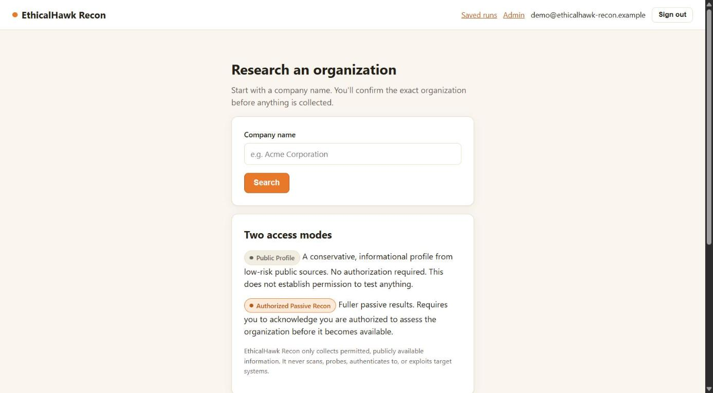
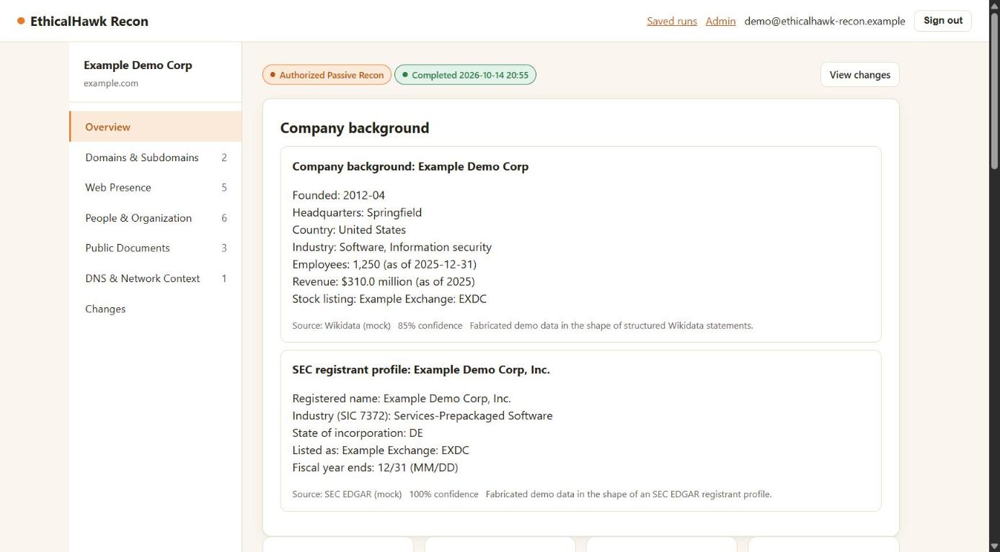
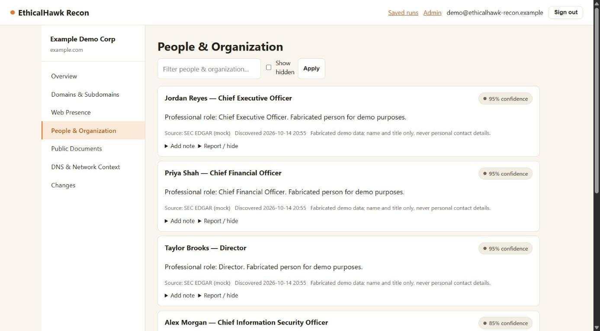
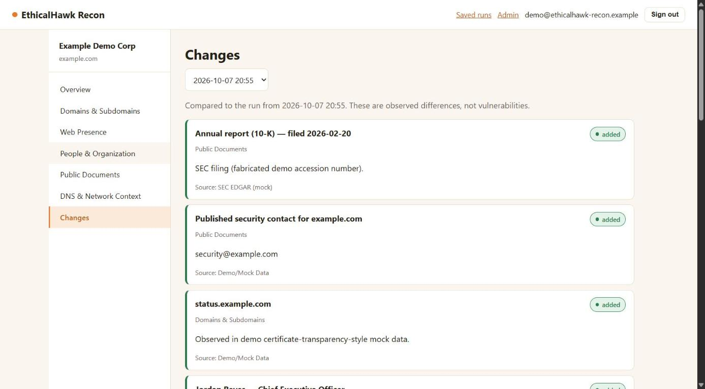

# EthicalHawk Recon

Authorization-aware, passive-reconnaissance research tool. See [PROGRAM_REQUIREMENTS.md](PROGRAM_REQUIREMENTS.md) for the full product spec this implements.

This build targets the **lightweight MVP stack**: FastAPI + SQLAlchemy + SQLite, server-rendered Jinja2 + HTMX (progressive enhancement only — every core flow works with plain HTML forms), and a small bounded in-process job queue standing in for Celery/RQ + Redis. See [docs/THREAT_MODEL.md](docs/THREAT_MODEL.md) and [docs/SOURCE_POLICY.md](docs/SOURCE_POLICY.md) for the security/safety design.

## Screenshots

All screenshots use the built-in demo organization (`python -m app.seed`): a fictional company on the reserved `example.com` domain with fabricated, clearly labeled mock results — no real organization or person.

| Search | Overview with company background |
| --- | --- |
|  |  |

| People & Organization | Changes between runs |
| --- | --- |
|  |  |

## What it actually does

Real, keyless, ToS-friendly passive sources — no scraping of general-purpose search engines, no active scanning:

| Source | Category | Notes |
| --- | --- | --- |
| Public DNS resolution | DNS & Network Context | A/AAAA/MX/NS/TXT via recursive resolvers |
| RDAP (rdap.org) | DNS & Network Context | Structured domain registration data (WHOIS successor) |
| Certificate Transparency (crt.sh) | Domains & Subdomains | Subdomains observed in public CT logs |
| Wikipedia REST/opensearch APIs | Web Presence, People, search matching | Public summaries; best-effort leadership name extraction |
| Wikidata API | Web Presence (company background, subsidiaries, social accounts), People | Founding date, HQ, industry, employees, revenue, ownership, stock listing; founders/CEO/chair/board |
| SEC EDGAR (US public companies) | Web Presence (registrant profile), Public Documents, People | 10-K/10-Q/proxy/8-K links; directors and officers from Form 3/4 insider filings. Needs `SEC_CONTACT_EMAIL` |
| Organization's own homepage | Web Presence | Title/description/response headers, official social account links — the same GET a browser makes, SSRF-guarded, robots.txt-respecting |
| Organization's own conventional public paths | Public Documents, People | `/press`, `/investors`, `/security.txt`, leadership/team pages (schema.org `Person` data + name/title text), etc. on the confirmed domain only |

All outbound requests to target-controlled URLs go through `app/services/ssrf_guard.py`, which blocks private/loopback/link-local/reserved address space and re-validates every redirect hop.

## Local setup

```bash
python -m venv .venv
. .venv/Scripts/activate   # Windows Git Bash; use .venv\Scripts\Activate.ps1 in PowerShell
pip install -r requirements.txt
cp .env.example .env       # adjust SECRET_KEY for anything beyond local use; set SEC_CONTACT_EMAIL to enable SEC EDGAR

python -m app.seed         # optional: creates a demo account + demo org with mock data
uvicorn app.main:app --reload
```

Visit http://127.0.0.1:8000. The first account you register becomes an administrator.

## Tests

```bash
pytest
ruff check .
```

## Notes on this build vs. the full spec

- **Alembic** is not wired up; the SQLite schema is created via `Base.metadata.create_all()` on startup, appropriate for local/demo use per PROGRAM_REQUIREMENTS.md 10.1. A Postgres deployment should add Alembic migrations before going further.
- **Password reset** has no email service configured; the reset link is shown directly in the UI with a clear "demo build" banner instead of being emailed. Wire up real email delivery before any non-local deployment.
- **Document upload** is out of scope per PROGRAM_REQUIREMENTS.md 8.4 and is not implemented.
- The in-process job queue (`app/background.py`) only works within a single running process/replica. A multi-instance deployment needs a real broker (Celery/RQ + Redis, as the spec recommends).
